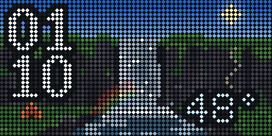
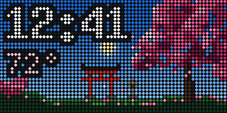
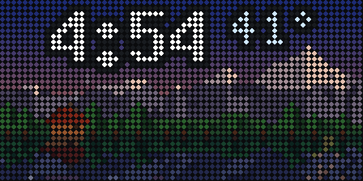
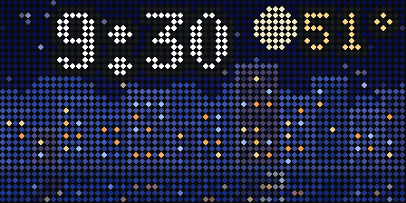
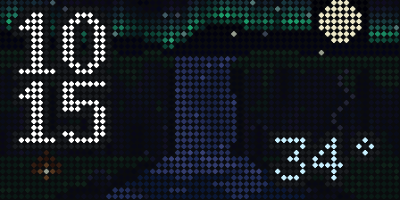
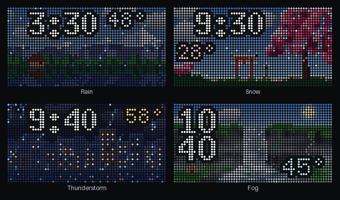
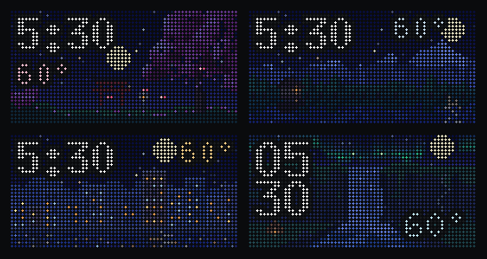
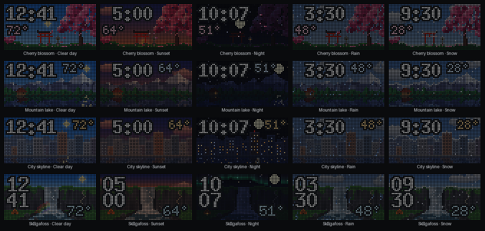
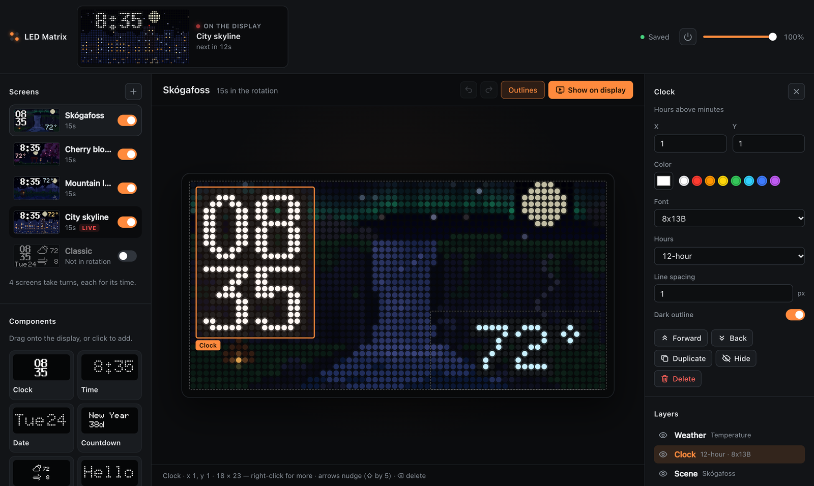
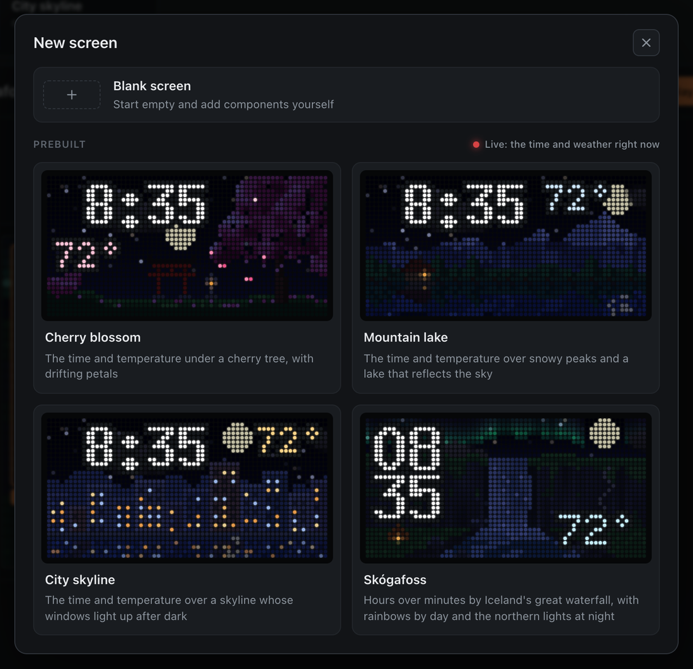

# LED Matrix Dashboard

A clock and weather display for a 64×32 RGB LED panel on a Raspberry Pi. It draws little animated pixel-art worlds that follow the real weather and time of day, and you arrange what it shows from a web page.

<p align="center">
  
</p>

Every picture here was drawn by the same code that drives the LEDs (`docs/render_media.py`), so it's exactly what the panel shows.

## Scenes

Four prebuilt screens put the time and temperature over an animated scene. Add one from the + next to Screens on the management page, which shows them all live.

<table>
  <tr>
    <td width="50%"></td>
    <td width="50%"></td>
  </tr>
  <tr>
    <td><b>Cherry blossom</b>: a cherry tree, a torii gate and a stone lantern. Petals drift off the tree, farther when it's windy, and the lantern glows after dark.</td>
    <td><b>Mountain lake</b>: snowy peaks over a lake that mirrors the sky. The water ripples, the sun or moon glitters on it, and the cabin's chimney smokes on cold days.</td>
  </tr>
  <tr>
    <td></td>
    <td></td>
  </tr>
  <tr>
    <td><b>City skyline</b>: a skyline by a river. Windows light up one by one as it gets dark, change through the night, and wobble in the water. A warning light blinks on the tallest tower.</td>
    <td><b>Skógafoss</b>: Iceland's great waterfall, with spray rising from the pool and a tent glowing by the river. A rainbow hangs in the mist on sunny days, and the northern lights come out on clear nights. This is the screen a new display starts with.</td>
  </tr>
</table>

### They follow the weather

<p align="center">
  
</p>

Scenes use the same OpenWeatherMap data as the Weather component, checked every 15 minutes:

- **Clear**: the sun by day; the moon in its real phase and twinkling stars by night, with the odd shooting star
- **Clouds**: a few drifting clouds, up to a gray overcast sky
- **Rain**: falling streaks that splash where they land, heavier for steady rain than for showers
- **Thunderstorm**: heavy rain and flashes of lightning
- **Snow**: drifting flakes, and snow settling on rooftops, the torii, the tree and the peaks
- **Fog**: mist rolling across the lower half

Wind speed pushes the clouds, petals, smoke and rain along.

### And the time of day

<p align="center">
  
</p>

The sky goes from night to sunrise, day, sunset and dusk, timed by today's sunrise and sunset where you live. The sun sinks behind the scenery, the moon rises, and lanterns and windows come on as it gets dark.

### Every scene, every sky



## Managing the display

<p align="center">
  
</p>

Open `http://<the Pi's address>:5000` in a browser on your network (for example http://192.168.1.31:5000). It has no login, so only run it on a network you trust.

- **Screens**: the display shows one screen at a time. Screens with "Take turns" on are shown in order, each for its time. "Show on display" puts the screen you're editing on now.
- **New screens**: the + next to Screens lets you start from a blank screen or pick a prebuilt one. The prebuilt previews are live, so each shows the time and weather right now, moving just as it will on the display. Once added it's an ordinary screen you can change.
- **Scenes**: the Scene component is the animated background behind the prebuilt screens, and you can put one behind any screen. It always goes under everything else. Its settings pick the scene, and can fix the weather or time of day instead of following them, which is handy for trying each look (the editor redraws it once a second; the display runs it at full speed). A brightness setting dims just the background.
- **Components**: drag them from the list onto the display, then drag them around. Click one to change its settings (font, color, format, and so on). Arrow keys nudge it one LED at a time. There are clocks, the date, a countdown, the weather, text that can scroll, images and boxes. The Weather component's "Show" setting picks what it shows: the weather icon with the temperature and wind, just the temperature, one detail (feels like, high and low, humidity, wind, sunrise or sunset), or the forecast for the next few days or hours. Everything with text has a "Dark outline" setting that keeps it readable over a scene or a bright sky.
- **Images**: drop an image file onto the display, or upload one in an Image component's settings. PNG, JPG, GIF and WebP work, and animated GIFs play on the display. The weather icons are there to use too, in any color.
- **Right-click** a component, an empty spot on the display, or a screen for shortcuts: copy and paste (also between screens), layer order, centering, hide, delete, or adding a component at that spot.
- **Live view**: the top bar shows what the display is showing right now, and has the brightness control.

<p align="center">
  
</p>

Changes save as you make them, and the display picks them up right away. ⌘Z / Ctrl+Z undoes them. The editor previews are drawn by the same code that drives the LEDs, so they match the panel pixel for pixel.

The layout is saved in `data/display.json` and uploaded images in `data/images/`. Git ignores `data/`, so deploys don't touch it. Delete `data/display.json` to go back to the default layout: the Skógafoss screen, plus the original clock, date and weather as a "Classic" screen that's out of the rotation.

The Weather component and the scenes use the OpenWeatherMap settings in `.env`. Until weather has loaded, the editor shows sample weather so you can lay things out, and the display leaves those spots blank.

### Running it on your computer

You can run the dashboard without a Pi or LED panel to work on the page or try out layouts. Frames then only show in the page.

```bash
python3 -m venv .venv && .venv/bin/pip install flask pillow requests python-dotenv
```

```bash
LED_EMULATOR=1 PORT=5050 .venv/bin/python main.py
```

Then open http://localhost:5050. (On macOS port 5000 is taken by AirPlay.) Set `LED_LAYOUT_FILE=/some/file.json` to keep your experiments out of `data/`.

### Adding a component

Each component is a class in `components/` (see `components/base.py`). It says how big its box is and draws into a Pillow image of that size, and it lists its settings as `Option`s. The page builds its settings form from those, so a new component only needs its class added to `COMPONENTS` in `components/__init__.py`. Data that's slow to get, like the weather, goes in a `PollingSource` (see `components/weather.py`) so drawing never waits on the network.

Scene themes are classes in `components/scene.py` and prebuilt screens are entries in `prebuilt.py`. After changing either, `.venv/bin/python docs/render_media.py` redraws the pictures in this README.

Tests are in `tests/` and run before every deploy:

```bash
.venv/bin/python -m unittest discover -s tests -t .
```

## Setting up a Pi

Works on Raspberry Pi OS Bookworm or newer (the LED driver needs Python 3.11+). The same steps set up another Pi.

1. Clone this repo on the Pi as your normal user (not root).
2. Create `.env` in the project folder with your weather settings:

   ```
   OPENWEATHERMAP_API_KEY=your-key
   LAT=12.34
   LON=-56.78
   ```

3. From the project folder, run:

   ```bash
   sudo deploy/install.sh
   ```

`install.sh` installs the system packages it needs, installs `requirements.txt` into a venv (building the LED driver from the commit pinned there, which takes a few minutes), and starts the app. It's safe to re-run.

The app runs as root under supervisor, so the LED library can set up precise timing. Right after setup the app switches to the user who owns the project folder.

## The LED driver

The display uses [hzeller/rpi-rgb-led-matrix](https://github.com/hzeller/rpi-rgb-led-matrix). It has no releases, so `requirements.txt` pins it to an exact commit, and every Pi builds that same commit.

To move to the latest upstream version, run this on your computer:

```bash
deploy/pin-driver.sh
```

It updates `requirements.txt` and prints a link to what changed upstream. Commit and push it like any other change. The Pi builds the new driver while the app keeps running, and rolls back if the app doesn't come up (see below). To pin a specific commit instead, pass its full SHA: `deploy/pin-driver.sh <sha>`.

The driver is compiled against the C headers of the Pillow version pinned in `requirements.txt` (its `SetImage()` reads Pillow's memory directly), so keep pillow pinned with `==`.

## Automatic deploys

`install.sh` also turns on automatic deploys: every 2 minutes the Pi checks GitHub, and when `main` has a new commit it:

1. installs its `requirements.txt` into a new venv, if that changed, while the app keeps running
2. tests it in a scratch copy: everything compiles, `main.py` imports, and unit tests in `tests/` pass (if that folder exists)
3. fast-forwards the checkout, switches to the new venv and restarts the app
4. checks `http://127.0.0.1:5000/health`, and rolls back to the previous commit and venv if the app doesn't come up

A commit that fails is skipped until something newer is pushed.

Each version of `requirements.txt` gets its own venv in `.venvs/`, and `.venv` is a link to the one in use. Deploys keep the current and previous venvs and delete older ones.

- Deploy logs: `journalctl -u led-deploy -f`
- App logs: `/var/log/led_matrix_dashboard.out.log` and `.err.log`
- Deploy right now: `sudo deploy/deploy.sh` (add `--force` to redeploy or retry a failed commit)
- Pause auto-deploys: `sudo systemctl disable --now led-deploy.timer`
